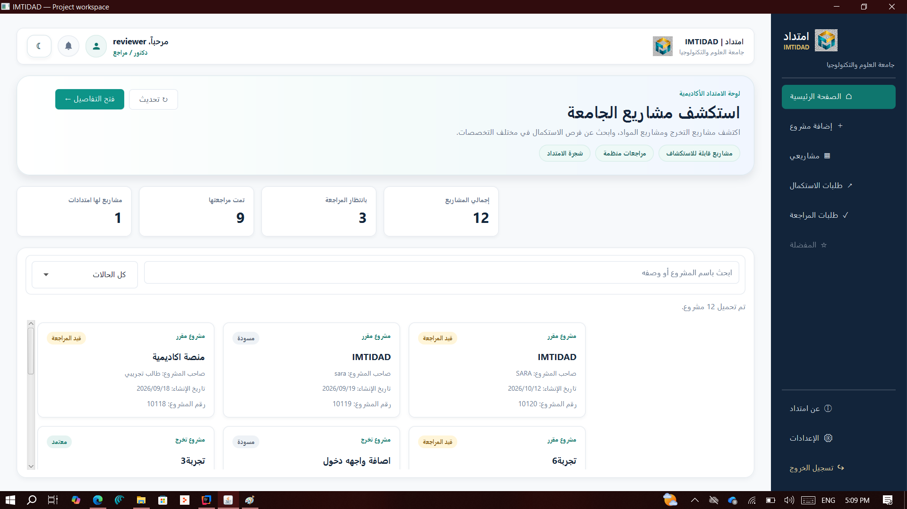
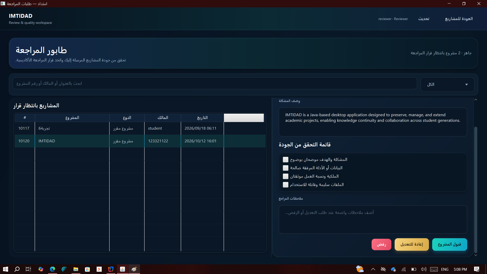
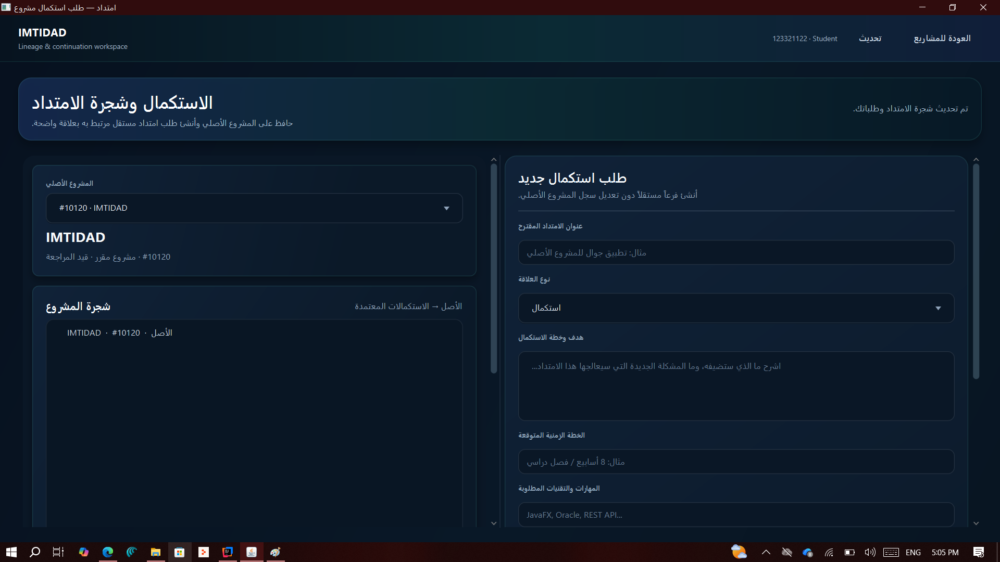
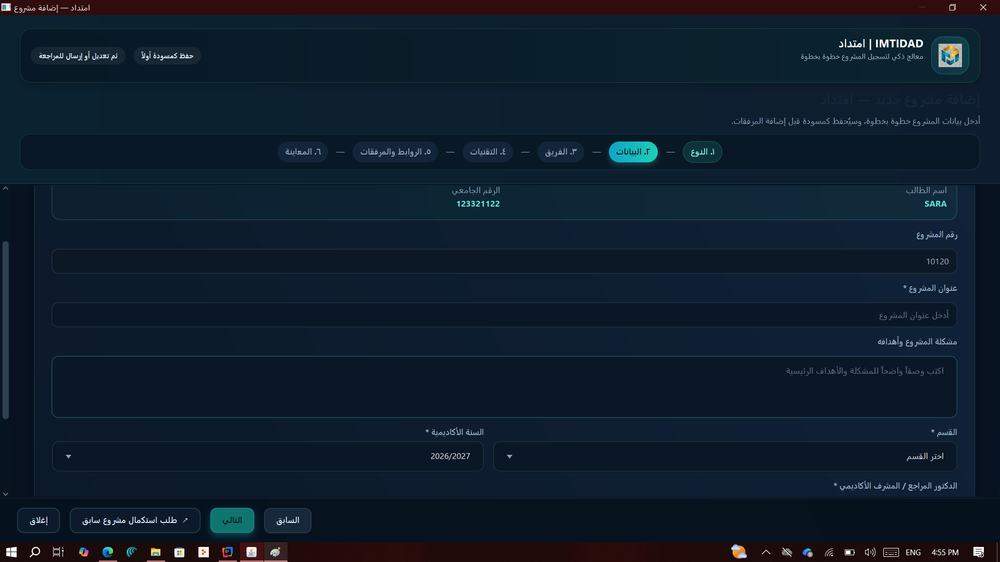
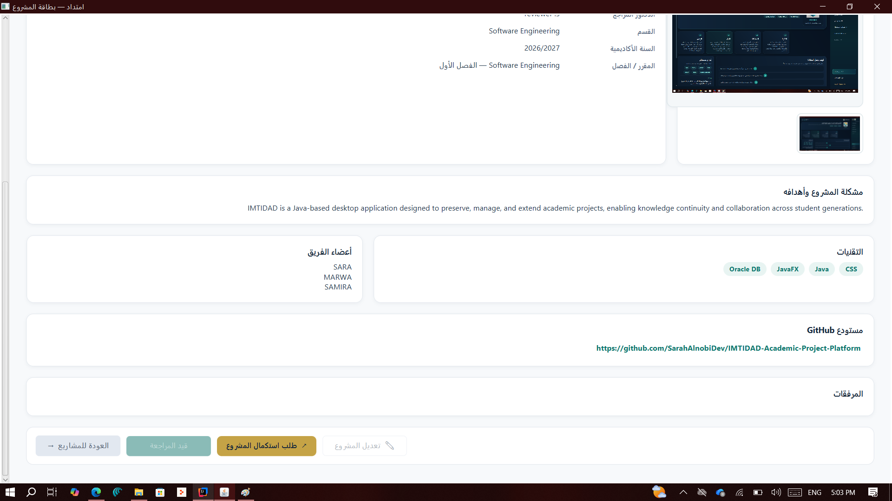
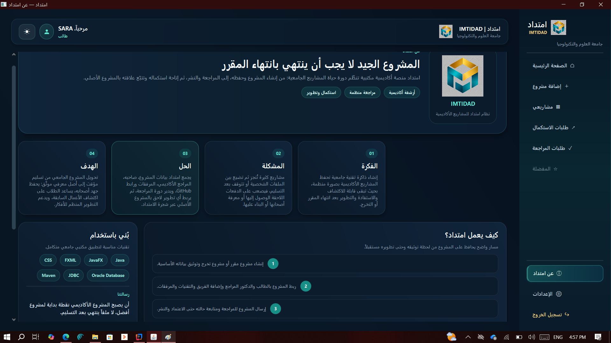

<div align="center">

# IMTIDAD | امتداد

### 🎓 University Student Project Knowledge & Continuity Platform

**Beyond Submission, Knowledge Continues.**

*A place where academic projects are preserved, explored, and extended across generations.*


</div>

---

## 🌍 About IMTIDAD

Every year, universities produce outstanding student projects across different courses and graduation programs. Yet, many of these projects lose their value after submission, remaining scattered across libraries, personal devices, and academic archives.

**IMTIDAD (امتداد)** is a university knowledge platform designed to preserve, organize, and connect outstanding academic projects.

Rather than treating projects as temporary academic assignments, IMTIDAD aims to transform them into a **growing knowledge repository** that future generations of students can explore, learn from, and build upon.

Students can discover ideas from previous cohorts, explore projects developed in earlier courses, understand the technologies used, and find opportunities to continue existing work.

The platform also aims to build a **technical history of the university**, documenting how projects, technologies, ideas, and student contributions evolve over time.

> **IMTIDAD is more than a project archive — it is a bridge connecting academic knowledge across generations.**

---

## 🎯 The Mission

**Turning academic projects from temporary submissions into lasting knowledge.**

IMTIDAD seeks to:

- Preserve valuable academic efforts.
- Make previous student projects easier to discover.
- Help students learn from earlier academic experiences.
- Encourage the continuation and improvement of existing projects.
- Document project ownership, technologies, and contributions.
- Build a lasting record of academic innovation.

---

## ✨ Key Features

| Feature | Description |
|---------|-------------|
| 🗂️ **Academic Repository** | Preserve and organize course and graduation projects. |
| 🔎 **Project Discovery** | Explore previous projects, ideas, and technologies. |
| 🎓 **Academic Review** | Manage project evaluation, feedback, and approval. |
| 🪪 **Project Passport** | Display project details, contributors, and resources. |
| 🌱 **Project Continuation** | Request to extend or improve an existing project. |
| 🌳 **Project Lineage** | Connect original projects with their later developments. |

---

## 🔄 How IMTIDAD Works

IMTIDAD supports a structured academic project lifecycle:

<div align="center">

**📝 Create → 📋 Document → 🎓 Review → ✅ Approve → 📚 Publish → 🌱 Extend**

</div>

Students document their academic projects and submit them for review.

Academic reviewers evaluate submitted projects, provide feedback, and determine whether they are ready for publication.

Published projects become available for exploration, allowing future students to discover previous work and request its continuation.

Project relationships help preserve the history of academic contributions and development.

---

## 🖼️ Application Screenshots

Explore the desktop interface of IMTIDAD and its main workflows.

### 🏠 Main Dashboard

The main workspace for exploring academic projects and accessing the application's features.

<div align="center">



</div>

### 🎓 Academic Review & 🌱 Project Continuation

<table>
<tr>
<td align="center" width="50%">

**Academic Review**



</td>
<td align="center" width="50%">

**Project Continuation**



</td>
</tr>
</table>

### 📝 Project Registration & 🪪 Project Passport

<table>
<tr>
<td align="center" width="50%">

**Project Registration**



</td>
<td align="center" width="50%">

**Project Passport**



</td>
</tr>
</table>

### 💡 About IMTIDAD

<div align="center">



</div>

---

## 🛠️ Technologies Used

| Technology | Purpose |
|------------|---------|
| ☕ **Java 21** | Core application development |
| 🖥️ **JavaFX & FXML** | Desktop user interface |
| 🎨 **CSS** | Interface styling |
| 🗄️ **Oracle Database** | Data storage and management |
| 🔗 **JDBC** | Database connectivity |
| 📦 **Maven** | Dependency and build management |

### 🧩 Architecture & OOP

IMTIDAD follows a layered software architecture:

`JavaFX / FXML → Controllers → Services → Repositories → Oracle Database`

The application demonstrates key Object-Oriented Programming concepts:

**Encapsulation · Abstraction · Inheritance · Polymorphism · Interfaces**

---

## 🚀 Getting Started

### 📋 Requirements

- JDK 21
- Apache Maven
- Oracle Database

### ⚙️ Installation

**1. Clone the repository:**

```bash
git clone https://github.com/SarahAlnobiDev/IMTIDAD-Academic-Project-Platform.git
```

**2. Navigate to the project directory:**

```bash
cd IMTIDAD-Academic-Project-Platform
```

**3. Configure the database:**

Use `src/config.properties.example` as a template to create your local `src/config.properties` file.

Set your Oracle Database connection information.

**4. Build and run the application:**

```bash
mvn clean compile
mvn javafx:run
```

> 🔐 **Security Note:** Never commit your actual database credentials to GitHub.

---

## 📚 Technical Documentation

For more information about the system architecture, database design, implementation, and OOP concepts:

📖 **[Explore the Technical Documentation](IMTIDAD_DOCUMENTATION.md)**

---

## 👩‍💻 Development Team

**🏛️ University of Science and Technology**

Faculty of Computing and Information Technology  
Department of Software Engineering

**Developed by:**

- **Sarah Alnobi — XZero**
- **Marwa Jameel**
- **Samira Al-Tabi**

📅 **2026**

---

## 🌱 Project Origins | MADA

IMTIDAD evolved from **MADA (مدى)**, an earlier academic project developed for a Database Systems course.

MADA focused on designing and implementing a relational database for preserving university student projects using **Oracle Database and SQL**, alongside an initial **Oracle APEX prototype**.

The concept was later developed into IMTIDAD, a Java-based desktop application applying Object-Oriented Programming principles.

🔗 **[Explore MADA — Database Systems Project](https://github.com/SarahAlnobiDev/mada-database-system)**

---

<div align="center">

### 🌟 IMTIDAD | امتداد

**Preserving Projects. Connecting Generations. Extending Knowledge.**

*Because the impact of a project goes beyond submission.*

**© 2026 — IMTIDAD Development Team**

</div>
